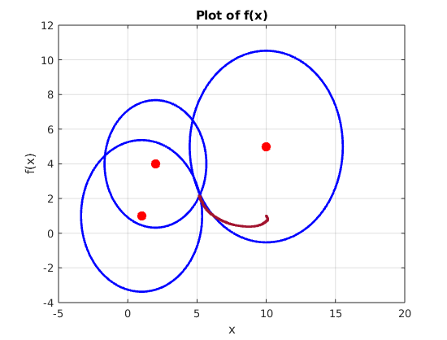
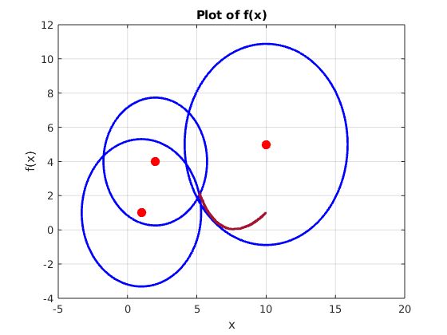
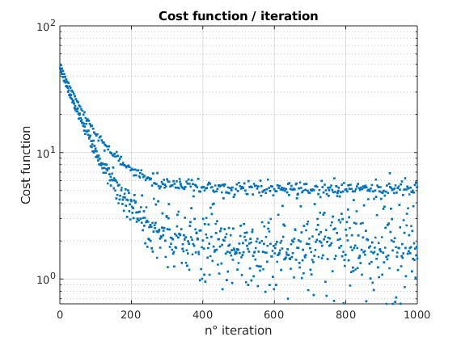

# LM Triangulation

**FR —** Estimer la position d’un téléphone à partir des distances mesurées par trois stations de base, avec une méthode d’optimisation non linéaire.<br>
**EN —** Estimate a phone’s position from distance measurements collected by three base stations using nonlinear optimization.



[Sommaire / Contents](#sommaire--contents) · [Rapport / Report](Report.pdf)

> **FR —** Aucune démonstration live ni URL de portfolio n’est fournie dans ce dépôt.<br>
> **EN —** No live demo or portfolio URL is provided in this repository.

## Sommaire / Contents

- [Présentation / Overview](#présentation--overview)
- [Méthodes et fonctionnalités / Methods and features](#méthodes-et-fonctionnalités--methods-and-features)
- [Problématique et approche / Problem and approach](#problématique-et-approche--problem-and-approach)
- [Choix techniques / Technical decisions](#choix-techniques--technical-decisions)
- [Résultats et apprentissages / Results and learnings](#résultats-et-apprentissages--results-and-learnings)
- [Getting started](#getting-started)
- [Structure du dépôt / Repository structure](#structure-du-dépôt--repository-structure)

## Présentation / Overview

**FR —** Ce projet explore la localisation en deux dimensions d’un téléphone à partir de ses distances à trois stations de base, dont les coordonnées sont connues. Il s’adresse aux personnes qui souhaitent étudier l’estimation de position à partir de mesures bruitées et comparer des variantes de l’algorithme de Levenberg–Marquardt. Il a été réalisé dans le cadre d’un travail sur les méthodes d’optimisation numérique.

**EN —** This project explores two-dimensional phone positioning from distances to three base stations with known coordinates. It is intended for readers interested in estimating position from noisy measurements and studying variants of the Levenberg–Marquardt algorithm. It was created as part of a numerical optimization assignment.

## Problématique et approche / Problem and approach

**FR —** Chaque mesure définit un cercle autour d’une station ; le téléphone devrait se trouver près de leur intersection. Le bruit empêche généralement une intersection exacte. Le script ajuste donc une position en minimisant les écarts entre distances mesurées et distances calculées. Les mesures sont générées par trois fonctions MATLAB compilées fournies (`ping_stolp_1.p` à `ping_stolp_3.p`).

**EN —** Each measurement defines a circle around a station; the phone should lie near their intersection. Noise usually prevents an exact intersection, so the script adjusts a candidate position to minimize the differences between measured and calculated distances. Measurements are generated by three supplied compiled MATLAB functions (`ping_stolp_1.p` to `ping_stolp_3.p`).

<p align="center">
  
</p>

## Méthodes et fonctionnalités / Methods and features

**FR —**
- Calcule les distances prédites entre une position candidate et les stations, puis forme les résidus et la jacobienne utilisés par l’optimisation.
- Implémente et compare les mises à jour **Gauss–Newton**, **Levenberg–Marquardt** et **Levenberg–Marquardt pondérée**.
- Utilise un terme d’amortissement dans Levenberg–Marquardt pour stabiliser les pas ; la variante pondérée prend en compte l’inverse des variances estimées par station.
- Suit la trajectoire estimée, les résidus, le coût et le gradient, et produit des graphiques pour analyser la convergence.

**EN —**
- Calculates predicted distances from a candidate position to each station, then forms the residuals and Jacobian used by the optimizer.
- Implements and compares **Gauss–Newton**, **Levenberg–Marquardt**, and **weighted Levenberg–Marquardt** updates.
- Uses a damping term in Levenberg–Marquardt to stabilize steps; the weighted variant accounts for the inverse of the estimated per-station variances.
- Tracks the estimated trajectory, residuals, cost, and gradient, and plots them to study convergence.

## Choix techniques / Technical decisions

**FR —** Le projet est écrit sous forme de script MATLAB avec des fonctions locales pour la géométrie et les mises à jour numériques. Les fonctions de mesure `.p` étant compilées, leur implémentation ne peut pas être inspectée ni modifiée à partir de ce dépôt.

**EN —** The project is written as a MATLAB script with local functions for geometry and numerical updates. Since the measurement functions are compiled `.p` files, their implementation cannot be inspected or modified from this repository.

## Résultats et apprentissages / Results and learnings

<p align="center">
  
</p>


**FR —** Les essais montrent une diminution rapide du coût au début de l’optimisation, suivie de fluctuations. Le nombre d’itérations, à lui seul, ne garantit donc pas une meilleure estimation : le rapport observe notamment une instabilité lorsque Levenberg–Marquardt simple est prolongé jusqu’à 5 000 itérations. Le suivi de la convergence et le choix d’un critère d’arrêt sont essentiels.

La pondération fondée sur la variance permet d’étudier l’influence de l’incertitude propre à chaque station, mais n’a pas apporté d’amélioration nette dans les essais rapportés. Une méthode plus élaborée n’est pas automatiquement plus performante : son bénéfice dépend notamment de la qualité des mesures et de l’estimation des variances. Le projet met ainsi en pratique les résidus, la jacobienne, l’amortissement et la pondération, tout en soulignant l’importance de confronter les indicateurs numériques aux trajectoires visualisées.

**EN —** The trials show a rapid decrease in cost at the beginning of optimization, followed by fluctuations. Iteration count alone therefore does not guarantee a better estimate: the report notably observes instability when simple Levenberg–Marquardt is run for 5,000 iterations. Monitoring convergence and choosing a stopping criterion are essential.

Variance-based weighting makes it possible to study the influence of each station’s measurement uncertainty, but did not yield a clear improvement in the reported trials. A more sophisticated method is not automatically more effective: its benefit depends, among other things, on measurement quality and variance estimation. The project applies residuals, the Jacobian, damping, and weighting, while highlighting the importance of comparing numerical indicators with the estimated trajectories.

## Getting started

### Requirements

- MATLAB R2018b or later (the script uses local functions and `var(..., "all")`).
- The supplied `ping_stolp_1.p`, `ping_stolp_2.p`, and `ping_stolp_3.p` files in the project directory.

### Run

1. Clone or download this repository.
2. Open the project directory in MATLAB.
3. Run the main script:

```matlab
assignment1
```

The script opens figures and prints summary values in the MATLAB command window. No additional package installation or configuration is documented.

## Structure du dépôt / Repository structure

| Path | Description |
| --- | --- |
| `assignment1.m` | Main MATLAB script: measurements, weighted Levenberg–Marquardt update, and plots. |
| `circles.m` | Circle-generation and plotting helper functions. |
| `ping_stolp_1.p` – `ping_stolp_3.p` | Compiled measurement functions, one per station. |
| `medias/` | Existing figures from optimization runs. |
| `Report.pdf` | Project report. |
| `VAJA1_ang.docx` | Assignment brief. |
| `main_file.asv` | MATLAB autosave of an earlier script version. |
```
```